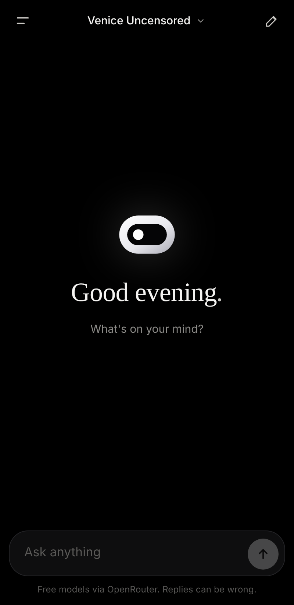
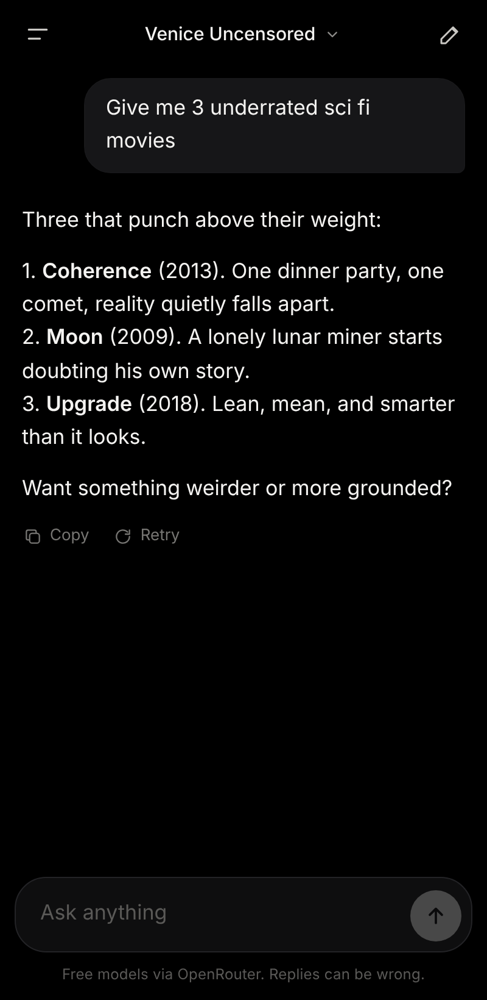
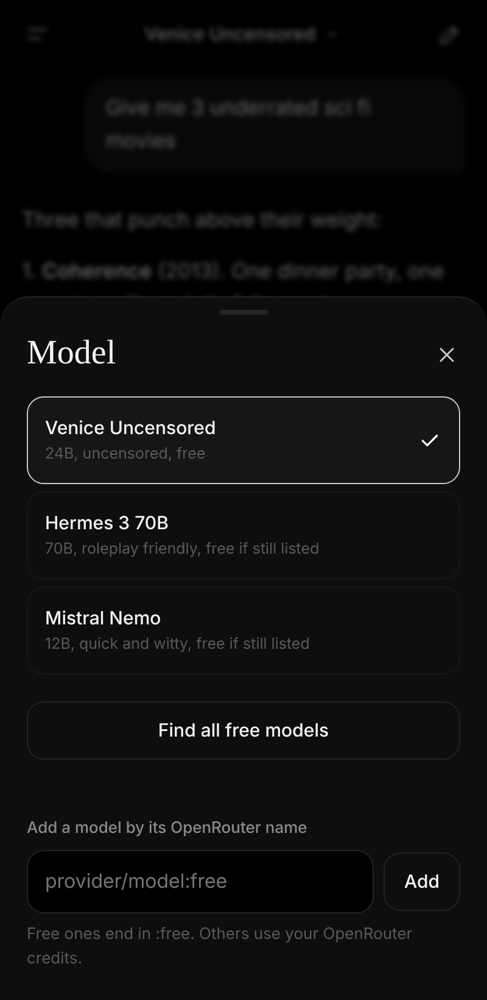

<p align="center">
  
</p>

<h1 align="center">Vesper</h1>

<p align="center">
  A fast, private AI chat app for your phone.<br>
  Free models, your own key, zero accounts, zero servers.
</p>

<p align="center">
  <a href="https://pushkarx-code.github.io/vesper/"><b>Open Vesper</b></a>
</p>

<p align="center">
  
  
  
</p>

## What it is

Vesper is a chat app that lives in your browser and installs to your home screen like a native app. It connects straight to [OpenRouter](https://openrouter.ai), so you can talk to dozens of AI models, including free ones, through one clean interface.

There is no backend. Nothing you type passes through a Vesper server, because there isn't one. Your key and your chats stay on your device.

## Features

* **Streaming replies.** Answers appear word by word, with a stop button when you've heard enough.
* **Any OpenRouter model.** Switch models from the top bar, even in the middle of a chat. One tap loads every free model that is live right now.
* **Chat history.** Every conversation is saved on your device and listed in the side drawer.
* **Follows your lead.** Ask a quick question, or set up a character and a scene in plain words. Vesper stays in character until you tell it to stop.
* **Custom instructions.** One optional box for anything it should always know or do.
* **Tunable.** Set the creativity and the reply length to taste.
* **Retry and copy.** Regenerate the last reply or copy any answer in one tap.
* **Installable.** Add it to your home screen and it opens full screen, with its own icon, like any other app.
* **Clear errors.** When a free model is busy or gone, Vesper says so in plain words and tells you what to do.

## Get started

**1. Open the app**

Go to [pushkarx-code.github.io/vesper](https://pushkarx-code.github.io/vesper/) in Chrome on your phone.

**2. Install it (optional, recommended)**

Tap the Chrome menu, then **Add to Home screen**, then **Install**.

**3. Add your key**

1. Create a free account at [openrouter.ai](https://openrouter.ai).
2. Open **Keys** and create a new key.
3. In Vesper, tap **Add API key**, paste it, then tap **Save key** and **Test**.

That's it. Start typing.

## Privacy

* Your API key is stored only in your browser's local storage on your device.
* Your chats are stored only on your device. Clearing the site data deletes them.
* Messages go directly from your browser to OpenRouter, and from there to the model provider you picked. Their privacy terms apply to that part of the trip.
* Vesper has no analytics, no tracking and no accounts.

Treat your key like a password. Never paste it into a chat, a screenshot or a public file.

## Models

Vesper ships with a short list of free models to get you going. Free models on OpenRouter change often and have rate limits, so if one stops responding:

1. Tap the model name at the top.
2. Tap **Find all free models** to load the current list.
3. Pick another one.

You can also add any model by its OpenRouter name. Names ending in `:free` cost nothing. Anything else uses your OpenRouter credits.

## Under the hood

* One HTML file with plain JavaScript and CSS. No framework and no build step.
* [marked](https://github.com/markedjs/marked) and [DOMPurify](https://github.com/cure53/DOMPurify) render replies safely as formatted text.
* A small service worker and a web manifest make it installable.
* Hosted for free on GitHub Pages.

### Project structure

```
index.html              The whole app: layout, styles and logic
manifest.webmanifest    Install settings (name, icons, colours)
sw.js                   Service worker for install and offline shell
icon.svg, icon-*.png    App icons
docs/                   Screenshots for this README
```

### Run it yourself

Fork this repo, turn on GitHub Pages for the `main` branch, and you have your own copy. To try it on a computer, serve the folder with any static server:

```
npx serve .
```

## Good to know

* Vesper needs an internet connection to chat. The models run in the cloud, not on your phone.
* AI models make mistakes and can state wrong things with confidence. Check anything important.
* The screenshots above show sample conversations.

## Credits

Designed and directed by [Pushkar Choudhury](https://github.com/PushkarX-Code). Built with [Claude](https://claude.com).
