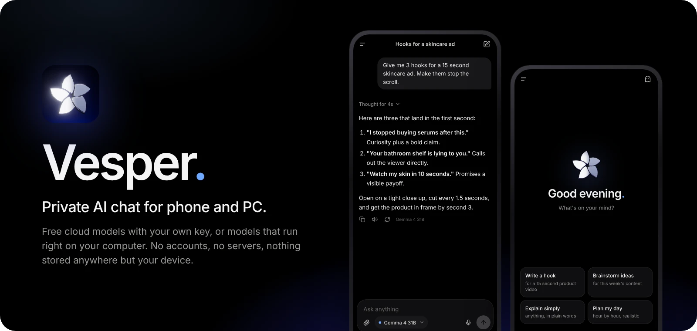
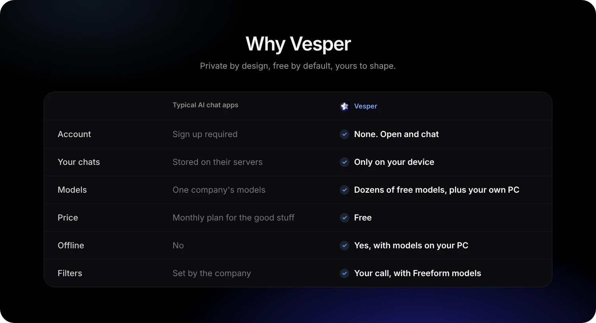
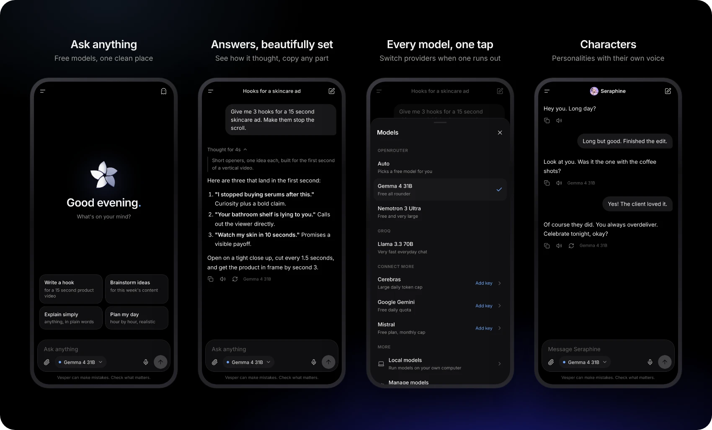
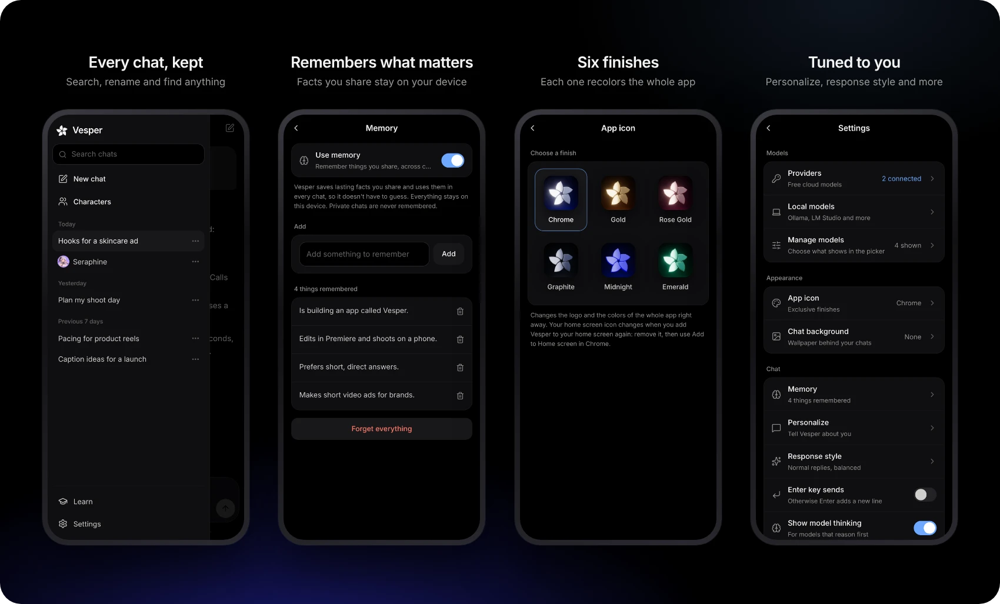
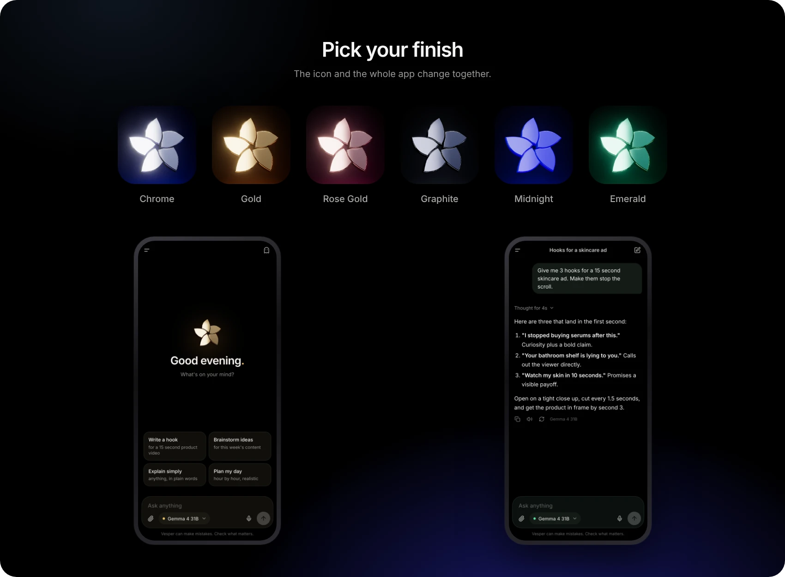
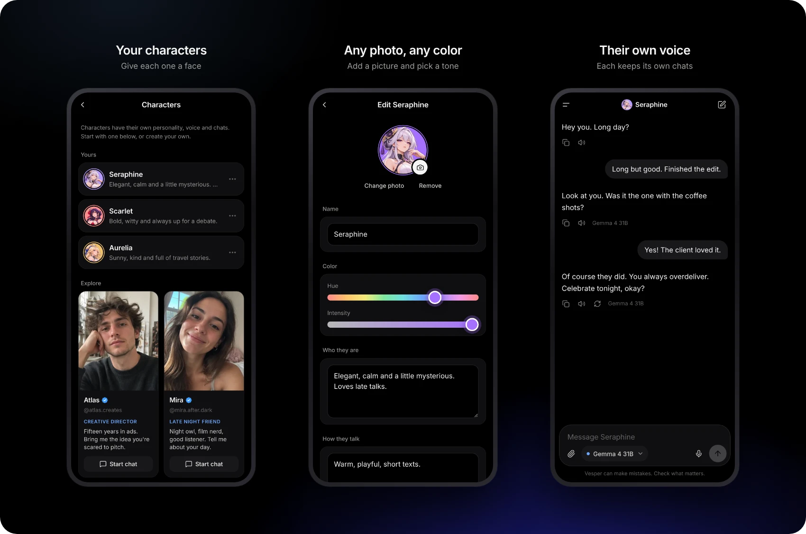
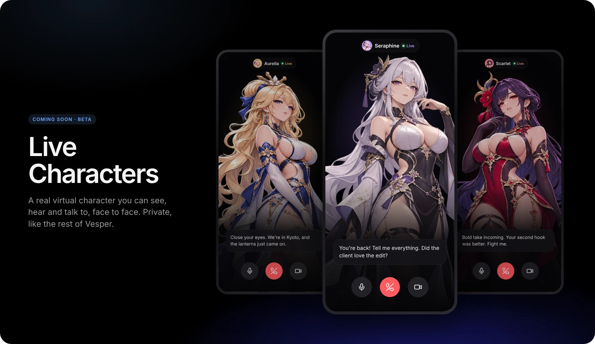
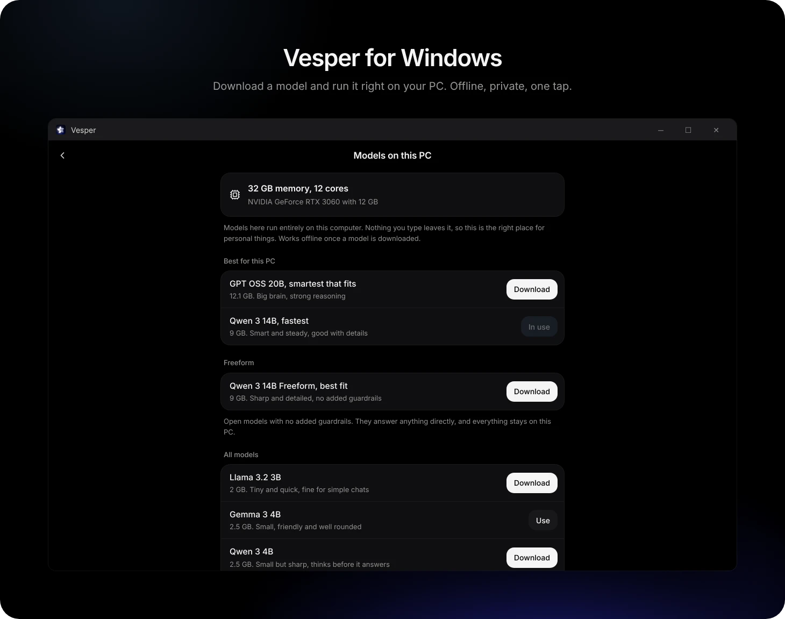

<p align="center">
  <a href="https://pushkarx-code.github.io/vesper/"></a>
</p>

<p align="center">
  <a href="https://pushkarx-code.github.io/vesper/"><b>Open Vesper</b></a>
</p>

## What it is

**Free, private AI on your phone and PC. No account, no subscription, nothing stored on a server.**

Vesper is a chat app that lives in your browser and installs to your home screen like a native app. It connects straight to free AI providers (OpenRouter, Groq, Cerebras, Google Gemini and Mistral), or to models running on your own computer, so you can talk to dozens of models through one clean interface.

There is no backend. Nothing you type passes through a Vesper server, because there isn't one. Your key and your chats stay on your device.

## Why Vesper

<p align="center">
  
</p>

## A closer look

<p align="center">
  
</p>

## Features

<p align="center">
  
</p>

Also in the box: chat backgrounds (presets or your own photo), update alerts with what's new, a **Learn** section with short guides, real screens and honest model picks (worth it or skip), photo and file attachments, talk instead of typing, read aloud, pinned chats, share a chat, edit and resend, retry, copy, code blocks with a copy button, a private chat that is never saved, chat search, rename, export and import, a collapsible view of a model's thinking, and plain language errors that tell you what to do when a free model is busy or gone. The Android back button closes panels like a native app. Pick an app icon finish in Settings: Chrome, Gold, Rose Gold, Graphite, Midnight or Emerald. Each one recolors the whole app.

<p align="center">
  
</p>

**Characters.** Start with a ready character (a creative director, a late night friend, an adventure narrator, a tutor, an honest critic and more) or create your own with a name, personality, way of talking and first message. The eight ready characters are verified by Vesper and have their own profiles. Give your own characters a face with any photo, and pick their color on a smooth hue and intensity slider. Each keeps its own chats.

<p align="center">
  
</p>

**Memory.** Vesper saves lasting facts you share and uses them in every chat, so it doesn't have to guess. You can see, add and delete them in Settings. They stay on your device, and private chats are never remembered.

**Find your model.** In Settings, Local models, tell Vesper your computer's memory and graphics card and it suggests the local models that will run well, with the command to download them.

## Coming soon: Live Characters (Beta)

A real virtual character you can see, hear and talk to, face to face. It will run on the same private setup as the rest of Vesper: no account, and your chats stay yours. You can already find **Live Characters** in the sidebar as a first look while we build it.

<p align="center">
  
</p>

## Get started

**1. Open the app**

Go to [pushkarx-code.github.io/vesper](https://pushkarx-code.github.io/vesper/) in Chrome on your phone.

**2. Install it (optional, recommended)**

Tap the Chrome menu, then **Add to Home screen**, then **Install**.

**3. Add a key**

In Vesper, tap **Connect a model** (or open **Settings**, then **Providers**), pick a provider and follow the short steps shown there to get a free key. Paste it, then tap **Save key** and **Test**. Every free tier has a daily limit, so adding two or three providers means you never run dry.

That's it. Start typing.

## Windows app

<p align="center">
  
</p>

Vesper also comes as a Windows app, built from the same code. Get the setup file from the repo's Releases page and run it. Windows may say "Windows protected your PC" because the app isn't signed yet: click More info, then Run anyway.

The Windows app can run models right on your PC, with nothing to install besides Vesper:

1. Open **Settings**, then **Local models**, then **Models on this PC**.
2. Vesper reads your memory and graphics card and suggests the models that fit.
3. Tap **Download**, then **Use**. The model runs offline, and nothing you type leaves your computer.

The **Freeform** section lists open models with no added guardrails. They answer anything directly, and everything stays on your PC.

It uses the llama.cpp engine with Vulkan, so it works on Nvidia, AMD and Intel graphics, and on the processor alone. Picking an app icon finish also changes the taskbar icon.

## Privacy

* Your API key is stored only in your browser's local storage on your device.
* Your chats are stored only on your device. Clearing the site data deletes them.
* Messages go directly from your browser to the provider you picked, and from there to the model provider you picked. Their privacy terms apply to that part of the trip.
* Vesper has no analytics, no tracking and no accounts.

Treat your key like a password. Never paste it into a chat, a screenshot or a public file.

## Models

Vesper ships with a short list of free models to get you going. Switch models from the chip in the message box. Free models change often and have rate limits, so if one stops responding:

1. Open **Settings**, then **Manage models**.
2. Tap **Find new models** to load the current lists. New finds start hidden so the picker stays short.
3. Turn on the ones you want.

You can also add any model by its exact name. On OpenRouter, names ending in `:free` cost nothing.

## Local models

Vesper can talk to a model running on your own computer through Ollama, LM Studio, llama.cpp or any OpenAI compatible server. The computer can stay offline; it only needs to share a WiFi network with your phone.

1. Open **Settings**, then **Local models**, then **Add a local model**.
2. Pick your app and enter your computer's WiFi address, for example `http://192.168.1.20:11434/v1` for Ollama.
3. Follow the setup steps shown in the app. For Ollama that means setting `OLLAMA_HOST=0.0.0.0` and `OLLAMA_ORIGINS=https://pushkarx-code.github.io`, then restarting it.
4. Tap **Connect**. When Chrome asks to let the site reach devices on your local network, tap **Allow**.

## Under the hood

* One HTML file with plain JavaScript and CSS. No framework and no build step.
* [marked](https://github.com/markedjs/marked) and [DOMPurify](https://github.com/cure53/DOMPurify) render replies safely as formatted text. Both ship in `vendor/`.
* [Inter](https://rsms.me/inter/) is the typeface, served from `fonts/`. Icons come from [Lucide](https://lucide.dev).
* No third party requests besides the AI provider you pick.
* A small service worker and a web manifest make it installable.
* The README pictures and the promo slides in `docs/promo/` are real screenshots with demo data, made by `node docs/art/make-art.js`.
* Hosted for free on GitHub Pages.

### Project structure

```
index.html              The whole app: layout, styles and logic
manifest.webmanifest    Install settings (name, icons, colours)
sw.js                   Service worker for install and offline shell
icons/                  Logo and app icons for every finish
learn/                  Screens for the in app Learn guides
chars/                  Portraits of the ready characters
version.json            Current version and notes for update alerts
manifest-*.webmanifest  Install settings for each finish
design/logo/            Logo source: geometry and 3D render scene
fonts/                  Inter variable font
vendor/                 marked and DOMPurify
desktop/                The Windows app (Tauri): native code, build scripts, app icons
docs/                   Screenshots for this README
```

### Run it yourself

Fork this repo, turn on GitHub Pages for the `main` branch, and you have your own copy. To try it on a computer, serve the folder with any static server:

```
npx serve .
```

## Good to know

* Vesper needs an internet connection to chat. The models run in the cloud, not on your phone.
* AI models make mistakes and can state wrong things with confidence. Check anything important.
* The screens in the images show sample conversations.

## Credits

Designed and directed by [Pushkar Choudhury](https://github.com/PushkarX-Code). Built with [Claude](https://claude.com).
