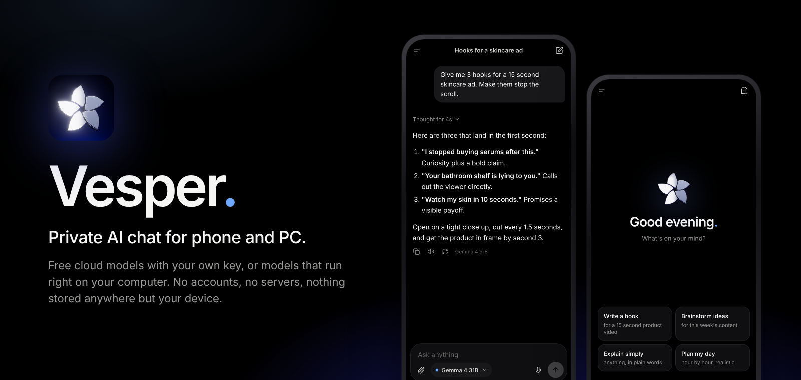
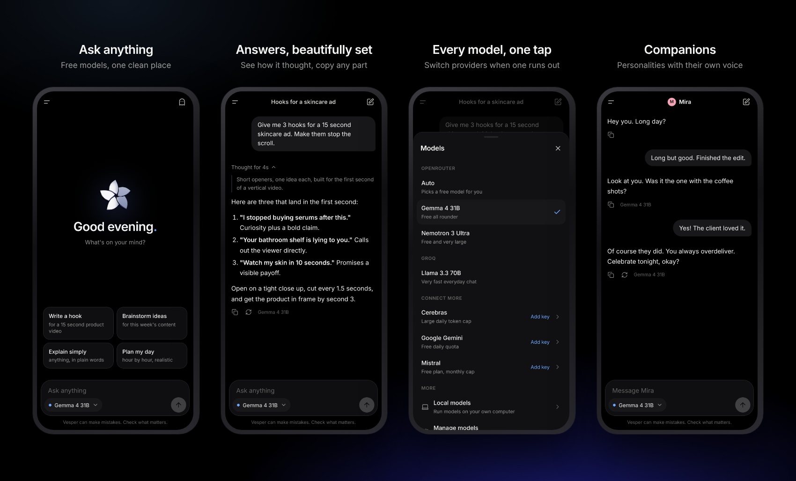
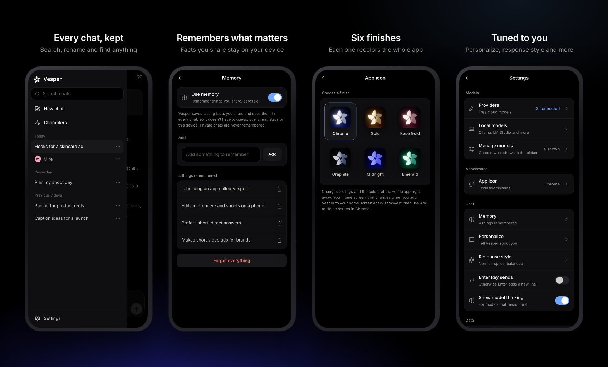

<p align="center">
  <a href="https://pushkarx-code.github.io/vesper/"></a>
</p>

<p align="center">
  <a href="https://pushkarx-code.github.io/vesper/"><b>Open Vesper</b></a>
</p>

## What it is

Vesper is a chat app that lives in your browser and installs to your home screen like a native app. It connects straight to free AI providers (OpenRouter, Groq, Cerebras, Google Gemini and Mistral), or to models running on your own computer, so you can talk to dozens of models through one clean interface.

There is no backend. Nothing you type passes through a Vesper server, because there isn't one. Your key and your chats stay on your device.

## A closer look

<p align="center">
  
</p>

## Features

<p align="center">
  
</p>

Also in the box: edit and resend, retry, copy, code blocks with a copy button, a private chat that is never saved, chat search, rename, export and import, a collapsible view of a model's thinking, and plain language errors that tell you what to do when a free model is busy or gone. The Android back button closes panels like a native app.

## Get started

**1. Open the app**

Go to [pushkarx-code.github.io/vesper](https://pushkarx-code.github.io/vesper/) in Chrome on your phone.

**2. Install it (optional, recommended)**

Tap the Chrome menu, then **Add to Home screen**, then **Install**.

**3. Add a key**

In Vesper, tap **Connect a model** (or open **Settings**, then **Providers**), pick a provider and follow the short steps shown there to get a free key. Paste it, then tap **Save key** and **Test**. Every free tier has a daily limit, so adding two or three providers means you never run dry.

That's it. Start typing.

## Privacy

* Your API key is stored only in your browser's local storage on your device.
* Your chats are stored only on your device. Clearing the site data deletes them.
* Messages go directly from your browser to the provider you picked, and from there to the model provider you picked. Their privacy terms apply to that part of the trip.
* Vesper has no analytics, no tracking and no accounts.

Treat your key like a password. Never paste it into a chat, a screenshot or a public file.

## Models

Vesper ships with a short list of free models to get you going. Switch models from the chip in the message box. Free models change often and have rate limits, so if one stops responding:

1. Open **Settings**, then **Manage models**.
2. Tap **Find new models** to load the current lists. New finds start hidden so the picker stays short.
3. Turn on the ones you want.

You can also add any model by its exact name. On OpenRouter, names ending in `:free` cost nothing.

## Local models

Vesper can talk to a model running on your own computer through Ollama, LM Studio, llama.cpp or any OpenAI compatible server. The computer can stay offline; it only needs to share a WiFi network with your phone.

1. Open **Settings**, then **Local models**, then **Add a local model**.
2. Pick your app and enter your computer's WiFi address, for example `http://192.168.1.20:11434/v1` for Ollama.
3. Follow the setup steps shown in the app. For Ollama that means setting `OLLAMA_HOST=0.0.0.0` and `OLLAMA_ORIGINS=https://pushkarx-code.github.io`, then restarting it.
4. Tap **Connect**. When Chrome asks to let the site reach devices on your local network, tap **Allow**.

## Under the hood

* One HTML file with plain JavaScript and CSS. No framework and no build step.
* [marked](https://github.com/markedjs/marked) and [DOMPurify](https://github.com/cure53/DOMPurify) render replies safely as formatted text. Both ship in `vendor/`.
* [Inter](https://rsms.me/inter/) is the typeface, served from `fonts/`. Icons come from [Lucide](https://lucide.dev).
* No third party requests besides the AI provider you pick.
* A small service worker and a web manifest make it installable.
* Hosted for free on GitHub Pages.

### Project structure

```
index.html              The whole app: layout, styles and logic
manifest.webmanifest    Install settings (name, icons, colours)
sw.js                   Service worker for install and offline shell
mark.webp, logo.svg     Logo: 3D render and flat version
icon-*.png              App icons
design/logo/            Logo source: geometry and 3D render scene
fonts/                  Inter variable font
vendor/                 marked and DOMPurify
docs/                   Screenshots for this README
```

### Run it yourself

Fork this repo, turn on GitHub Pages for the `main` branch, and you have your own copy. To try it on a computer, serve the folder with any static server:

```
npx serve .
```

## Good to know

* Vesper needs an internet connection to chat. The models run in the cloud, not on your phone.
* AI models make mistakes and can state wrong things with confidence. Check anything important.
* The screens in the images show sample conversations.

## Credits

Designed and directed by [Pushkar Choudhury](https://github.com/PushkarX-Code). Built with [Claude](https://claude.com).
